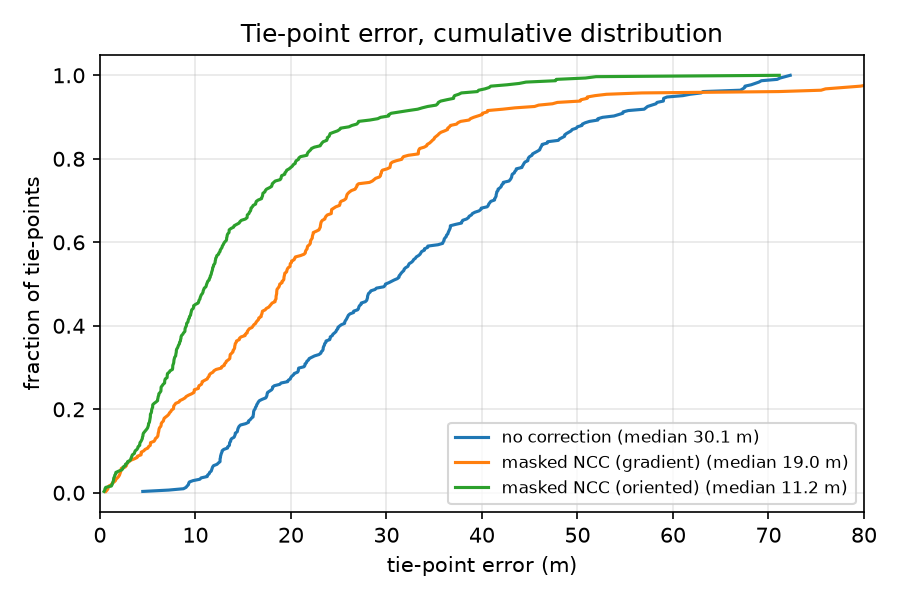
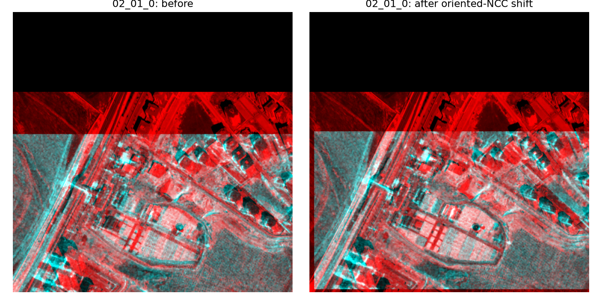

# SAR-optical registration on SpaceNet 9

An independent portfolio project (not affiliated with any company). It measures how well classical
feature matching can correct the residual misalignment between Umbra SAR and Maxar optical imagery
in the public SpaceNet 9 dataset, and it benchmarks FP32 vs INT8 inference for a small fusion network.

## What it does
1. Cuts a patch around each manually annotated tie-point **by map coordinates**, resampling optical and
   SAR onto one common grid (default 0.6 m). Pixel indices are never compared across images.
2. Estimates a SAR->optical transform from image content only, with four methods: identity (no
   correction), masked normalised cross-correlation of gradient maps, the same on oriented-gradient
   channels (robust to SAR/optical contrast reversal), and SIFT + ratio test + RANSAC similarity.
   Zero-padded raster margins are masked out: they otherwise create strong artificial edges.
3. Scores each method against the tie-point in metres. Failures are counted, not hidden.
4. Exports the displacement vectors as a GeoPackage in the scene's real CRS.
5. Measures FP32 vs INT8 latency with ONNX Runtime static quantization on real calibration patches.

## Data
SpaceNet 9 (Maxar Open Data optical + Umbra SAR, with manual tie-points), obtained from the Kaggle copy
`oguzuzan/sn9-cross-modal-satellite-imagery-registration`. Check the dataset licence before redistributing,
and cite the SpaceNet 9 papers (Hansch et al., IGARSS 2024; the SpaceNet 9 JSTARS paper). Data is not in this repo.
The `train` split has tie-points for only three scenes (151, 104 and 161 points; UTM 37N, optical 0.31 m, SAR 0.41-0.45 m, both uint8), so results come from a small number of locations. Raw tie-point misregistration is about 24-32 m (median) across the scenes.
Preprocessing choices were fixed in advance from the data type (uint8 SAR is not dB-scaled again), not tuned on the tie-points.

## Protocol
Resolution, smoothing and any confidence threshold are chosen on one **development scene (02_02)** only.
The numbers reported below come from the other two scenes (02_01, 03_01), which are not used for tuning.

## Run
```bash
pip install -r requirements.txt
python inspect_data.py --data-dir ./data --split train                     # check pairing, CRS, tie-point convention
python -m src.evaluate --scenes 02_02 --max-points 20 --out outputs/smoke # quick smoke test on the dev scene
python -m src.evaluate --scenes 02_02 --out outputs/dev                   # development run
python -m src.analyze_gate outputs/dev/per_tiepoint.csv                   # does the confidence score predict success?
# optional settings sweep on the dev scene only, then: python -m src.compare_runs outputs/dev_*
for p in 384 512 768; do for s in 2 3; do python -m src.evaluate --scenes 02_02 --patch $p --sigma $s --out outputs/dev_p${p}_s${s}; done; done
python -m src.evaluate --scenes 02_01,03_01 --out outputs/results         # final run (chosen settings): report these
python -m src.report outputs/results/per_tiepoint.csv                      # tables for this README
python -m src.make_figures --results outputs/results --out results         # figures for this README
python -m src.edge_benchmark --scenes 02_01,03_01 --calib-patches 32 --out-dir outputs/results
streamlit run app.py
pytest                                                                      # geometry and registration unit tests
```

## Results
Final run on scenes 02_01 and 03_01 (308 of 312 tie-points; 4 were skipped for too little overlapping valid
data). All design checks were made on the separate development scene 02_02. Generate this table with
`python -m src.report outputs/results/per_tiepoint.csv`.

| Method | Median error (m) | Mean (m) | P90 (m) | Improved | Worsened | Method succeeded |
|---|---|---|---|---|---|---|
| no correction | 30.1 | 31.9 | 53.0 | 0% | 0% | 100% |
| masked NCC (gradient) | 19.0 | 23.6 | 39.3 | 70% | 30% | 100% |
| masked NCC (oriented channels) | 11.2 | 14.1 | 29.6 | 82% | 18% | 100% |
| SIFT + RANSAC | 30.1 | 31.9 | 53.0 | 0% | 0% | 0% |

- Oriented-channel masked NCC cut the median tie-point error by about 63% (30.1 m to 11.2 m). The error is
  about 9 pixels at the 1.2 m working resolution, so no sub-pixel claim is made.
- 18% of tie-points got worse. One translation per 614 m patch cannot model terrain and layover distortion.
- SIFT + RANSAC found about 50 matches per patch but only about 3 inliers, so it rejected every patch.
- Confidence gating was tested on the development scene and gave no benefit (PSR AUC 0.68; NCC-peak AUC
  0.35), so none is applied.




### Edge benchmark (ONNX Runtime, CPU, this machine)
Static INT8 quantization of the 4-channel fusion U-Net, calibrated on 32 real SN9 patches (`outputs/results/benchmark.json`).

| | FP32 | INT8 |
|---|---|---|
| Model size | 1.91 MB | 0.52 MB |
| Median latency, 1x4x512x512 | 291 ms | 129 ms |
| Speedup | | 2.3x |

Mean relative logit drift after quantization is 0.24%. The network is untrained and its output is degenerate
(class 1 everywhere), so this is a size and latency benchmark only: no task accuracy is claimed, and the
argmax-agreement figure is uninformative. Timing varies by about 15% between runs (an earlier run gave 337 ms
vs 133 ms). The CPU numbers say nothing about Jetson or FPGA hardware.

For context, the SpaceNet 9 challenge reported reducing alignment error from roughly 34 m to under 13 m for
the top solutions, and recent papers report pretrained learned matchers reaching a few pixels of error on the
labelled training scenes. Those protocols differ from this one, so they are not directly comparable.

## Limitations
- Small evaluation set (three scenes), single global similarity transform per patch; terrain and building
  layover in SAR are not modelled.
- Tie-points are manual annotations with their own uncertainty; sub-pixel claims are not made.
- The fusion network is untrained. It is used only for size and latency, and no segmentation result is claimed.
- INT8 timings are from a CPU and say nothing about Jetson or FPGA targets.
- `src/dataset.py`, `src/evaluate.py`, `src/edge_benchmark.py` and `src/gis_export.py` need the real data and GPU/ONNX
  stack; unit tests cover only the geometry, registration and summary logic on synthetic data.
